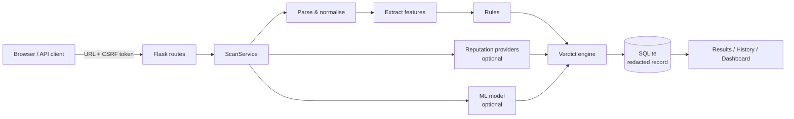

# PhishGuard

PhishGuard is a local web application that checks whether a link looks like phishing. It takes a URL apart the way a browser reads it, looks for the techniques phishing links rely on (borrowed brand names, look-alike characters, hidden destinations, disguised IP addresses), optionally asks threat-intelligence services and an optional machine-learning model, and explains its verdict in plain language.

**PhishGuard never opens, downloads or resolves the links you submit.** Its verdicts are assessments, not guarantees.

---

## Contents

1. [Features](#features)
2. [Technology stack](#technology-stack)
3. [Project structure](#project-structure)
4. [Architecture and data flow](#architecture-and-data-flow)
5. [Installation on Windows 11](#installation-on-windows-11)
6. [Configuration](#configuration)
7. [Database](#database)
8. [Running the application](#running-the-application)
9. [API usage](#api-usage)
10. [Detection methodology](#detection-methodology)
11. [Machine-learning pipeline](#machine-learning-pipeline)
12. [Testing, linting and security checks](#testing-linting-and-security-checks)
13. [Verification status](#verification-status)
14. [Security and privacy](#security-and-privacy)
15. [Known limitations](#known-limitations)
16. [Troubleshooting](#troubleshooting)
17. [Future improvements](#future-improvements)

---

## Features

* **Five distinct verdicts**: Confirmed malicious, High risk, Suspicious, No threat detected, Inconclusive. "No threat detected" always lists which checks ran and is never presented as "safe".
* **Strict URL validation**: HTTP/HTTPS only; IPv4 (including decimal/hex/octal obfuscation), IPv6, ports, Unicode/punycode, embedded credentials, invisible characters, configurable maximum length. Clear error messages.
* **27 documented detection rules** with rule ID, severity, explanation, evidence and advice: brand impersonation in subdomains or domains, homoglyph and typosquat look-alikes, `@` disguises, obfuscated IPs, encoded hostnames, free hosting, shorteners, executable downloads and more.
* **"Who controls this link"** view highlighting the registered domain — the only part that identifies the site owner.
* **Optional threat intelligence**: Google Safe Browsing, Google Web Risk and PhishTank adapters with timeouts, caching, quota cool-down and honest failure reporting (a failed lookup is never "clean").
* **Optional ML model**: reproducible scikit-learn pipeline (domain-grouped split, class-imbalance handling, threshold chosen on validation data, full metrics, versioned and hash-verified artifacts). The scanner works without it.
* **Scan history** per browser with search, verdict filter, pagination, single/total deletion and automatic expiry.
* **Dashboard** of your own local usage, with clearly-labelled synthetic demo data.
* **Versioned REST API** (`/api/v1`) with consistent JSON, validation, pagination, CSRF and rate limits.
* **Pages**: scanner, results, history, dashboard, methodology, privacy, API docs, error pages. Responsive, keyboard accessible, verdicts conveyed by icon + text (not colour alone).

## Technology stack

| Layer | Technology |
|---|---|
| Language | Python 3.12 or 3.13 (3.11 minimum) |
| Web | Flask 3.1, Blueprints, Jinja2 |
| Data | SQLAlchemy 2.0 via Flask-SQLAlchemy, Alembic via Flask-Migrate, SQLite (PostgreSQL-compatible) |
| Security | Flask-WTF (CSRF), Flask-Limiter, strict CSP and security headers |
| Detection | Standard library + `idna`; `requests` for reputation APIs |
| ML | scikit-learn, pandas, NumPy, joblib |
| Frontend | HTML5, CSS3, vanilla JavaScript (no frameworks, no CDN) |
| Quality | pytest, Ruff, Bandit, pip-audit |

Dependencies are listed with compatible-release ranges in `requirements.txt` / `requirements-dev.txt`. After installing, record the exact versions with `pip freeze > requirements.lock.txt`.

## Project structure

```
PhishGuard/
├── app.py                     # entry point (binds 127.0.0.1)
├── config.py                  # all settings, read from environment / .env
├── requirements.txt, requirements-dev.txt, pyproject.toml
├── .env.example, .gitignore
├── migrations/                # Alembic environment + initial migration
├── phishguard/
│   ├── __init__.py            # application factory
│   ├── extensions.py, cli.py
│   ├── routes/                # main, scan, history, dashboard, api, health (+ error handlers)
│   ├── detector/              # url_parser, url_features, rule_engine, verdict_engine,
│   │                          # scoring, explanations, public_suffix, brands
│   ├── intelligence/          # base, google_provider, phishtank_provider, cache, service
│   ├── ml/                    # preprocessing, train, evaluate, predict, model_metadata
│   ├── services/              # scan_service, history_service, analytics_service
│   ├── models/                # scan_record
│   ├── schemas/               # common (JSON envelope), scan
│   ├── security/              # validation, rate_limits, headers, privacy
│   ├── templates/             # base, index, results, history, dashboard, methodology,
│   │                          # privacy, api_docs, errors/error, _macros, _icons
│   └── static/                # css/{main,components,responsive}.css, js/*.js, images/
├── datasets/README.md         # how to obtain and prepare data
├── ml_artifacts/README.md     # where trained models go
├── scripts/                   # init_db, prepare_dataset, train_model, evaluate_model
├── tests/                     # pytest suite (see below)
└── docs/                      # architecture, detection_methodology, threat_intelligence,
                               # dataset_and_model, security, api
```

Differences from the original blueprint are listed in [docs/architecture.md](docs/architecture.md#deviations-from-the-original-blueprint).

## Architecture and data flow



Routes hold no detection logic; the `detector`, `intelligence` and `ml` packages do not depend on Flask or the database. Details: [docs/architecture.md](docs/architecture.md).

## Installation on Windows 11

All commands are for **PowerShell** in the project folder (in VS Code: *Terminal → New Terminal*).

1. **Check Python** (3.12 or 3.13 recommended; 3.11 is the minimum):

   ```powershell
   py --version
   ```

   If missing, install it from https://www.python.org/downloads/windows/ and tick *Add python.exe to PATH*.

2. **Create a virtual environment:**

   ```powershell
   py -3.12 -m venv .venv
   ```

   (Use `py -3.13` if that is the version you installed.)

3. **Activate it:**

   ```powershell
   .\.venv\Scripts\Activate.ps1
   ```

   If PowerShell blocks the script, run once: `Set-ExecutionPolicy -Scope CurrentUser RemoteSigned`, then activate again. In VS Code, choose *Python: Select Interpreter* → `.venv`.

4. **Install dependencies:**

   ```powershell
   python -m pip install --upgrade pip
   pip install -r requirements-dev.txt
   pip freeze > requirements.lock.txt
   ```

   (`requirements.txt` alone is enough to run the app; `-dev` adds pytest, Ruff, Bandit and pip-audit.)

5. **Configure** (optional — everything works with defaults):

   ```powershell
   Copy-Item .env.example .env
   python -c "import secrets; print(secrets.token_hex(32))"   # paste the output as SECRET_KEY in .env
   ```

6. **Initialise the database:**

   ```powershell
   python scripts\init_db.py
   ```

   This creates `instance\phishguard.db` via the Alembic migration. (The app also does this automatically on first start.)

7. **Start PhishGuard:**

   ```powershell
   flask --app app run
   ```

   Open http://127.0.0.1:5000. Add `--debug` for auto-reload while developing (never with untrusted users on the network). `python app.py` works too.

## Configuration

All settings come from environment variables or `.env` (see `.env.example`, which documents each one). Nothing is required.

| Setting | Default | Purpose |
|---|---|---|
| `SECRET_KEY` | generated into `instance/secret_key` | Signs session cookies and keys URL fingerprints |
| `DATABASE_URL` | `sqlite:///instance/phishguard.db` | Any SQLAlchemy URL (PostgreSQL needs a driver such as `psycopg`) |
| `MAX_URL_LENGTH` | 2048 | Longest accepted URL (64–8192) |
| `SCAN_RETENTION_DAYS` | 7 | Days before records are deleted (1–365) |
| `STORE_NORMALIZED_URL` | false | Also keep the normalised URL (no credentials/fragment) |
| `REQUIRE_REPUTATION_FOR_CLEAN` | false | Report *Inconclusive* instead of *No threat detected* unless a reputation lookup completed |
| `GOOGLE_SAFE_BROWSING_API_KEY` | – | Enables Safe Browsing (non-commercial use) |
| `GOOGLE_WEB_RISK_API_KEY` | – | Enables Web Risk (commercial, billing required) |
| `PHISHTANK_ENABLED`, `PHISHTANK_API_KEY`, `PHISHTANK_USERNAME` | false / – / – | Enables PhishTank |
| `INTEL_CONNECT_TIMEOUT`, `INTEL_READ_TIMEOUT`, `INTEL_CACHE_TTL_SECONDS` | 3.05 / 6 / 1800 | Provider timeouts and cache |
| `ML_MODEL_PATH`, `ML_ENABLED` | – / true | Trained model to load |
| `RATELIMIT_ENABLED`, `SCAN_RATE_LIMIT`, `RATELIMIT_DEFAULT` | true / `20 per minute;300 per day` / `200 per minute;5000 per hour` | Rate limits |
| `SESSION_COOKIE_SECURE` | false | Set true only when served over HTTPS |
| `LOG_LEVEL` | INFO | Logging verbosity (URLs are never logged) |

Never commit a populated `.env`; it is git-ignored.

## Database

* SQLite file `instance\phishguard.db`, table `scan_records` (schema in [docs/architecture.md](docs/architecture.md#data-model)).
* Create / upgrade: `python scripts\init_db.py` or `flask --app app init-db`.
* After changing models: `flask --app app db migrate -m "describe change"` then `flask --app app db upgrade`.
* Retention: expired records are hidden immediately and purged automatically (at most every five minutes while the app is used). Purge manually with `flask --app app purge-expired`.
* Reset everything: stop the app and delete `instance\phishguard.db`.

## Running the application

| Page | URL |
|---|---|
| Scanner | `/` |
| Result | `/scans/<id>` |
| History | `/history` |
| Dashboard | `/dashboard` (use *Add demo scans* to populate it with labelled synthetic data) |
| Methodology | `/methodology` |
| Privacy | `/privacy` |
| API docs | `/api-docs` |

## API usage

```powershell
$base = "http://127.0.0.1:5000/api/v1"
$s = Invoke-RestMethod "$base/session" -SessionVariable pg
$body = @{ url = "https://paypal.com.account-verify.example.net/signin" } | ConvertTo-Json
$r = Invoke-RestMethod "$base/scan" -Method Post -WebSession $pg -ContentType "application/json" `
       -Headers @{ "X-CSRFToken" = $s.data.csrf_token } -Body $body
$r.data.verdict          # high_risk
```

Endpoints: `GET /session`, `POST /scan`, `GET /scans`, `GET /scans/<id>`, `DELETE /scans/<id>`, `GET /health`, `GET /status`. Full reference: [docs/api.md](docs/api.md).

## Detection methodology

1. **Parse** like a browser; reject what is not a valid HTTP(S) URL with a clear reason.
2. **Extract** 47 lexical features plus evidence (brand mentions, look-alikes, mixed scripts, keywords...).
3. **Rules** produce findings with categorical severities (info/low/medium/high/critical).
4. **Reputation** lookups (if configured) and the **ML** estimate (if a model exists).
5. **Verdict precedence**: verified listing → Confirmed malicious; critical, 2× high, or high + corroboration → High risk; high, 2× medium, unverified listing or ML alone → Suspicious; missing necessary data → Inconclusive; otherwise No threat detected.

The 0–100 **heuristic risk index** is a capped sum of severity weights, labelled as not a probability. Full rationale, rule table and limitations: [docs/detection_methodology.md](docs/detection_methodology.md).

## Machine-learning pipeline

No model or accuracy figures are included. To train one:

```powershell
# 1. Download PhiUSIIL (CC BY 4.0) from https://archive.ics.uci.edu/dataset/967 into datasets\raw\
# 2. Prepare it (label 0 = phishing in this dataset)
python scripts\prepare_dataset.py --input datasets\raw\PhiUSIIL_Phishing_URL_Dataset.csv --url-col URL `
    --label-col label --phishing-value 0 --source-name "PhiUSIIL Phishing URL Dataset" --license "CC BY 4.0" `
    --source-url https://archive.ics.uci.edu/dataset/967 --output datasets\phiusiil.csv
# 3. Train and evaluate (domain-grouped split, metrics printed and saved)
python scripts\train_model.py --dataset datasets\phiusiil.csv
# 4. Enable it: put ML_MODEL_PATH=ml_artifacts\<version>.joblib in .env and restart
# 5. Later, evaluate on newer data
python scripts\evaluate_model.py --model ml_artifacts\<version>.joblib --dataset datasets\newer.csv
```

Details, biases and retraining guidance: [docs/dataset_and_model.md](docs/dataset_and_model.md).

## Testing, linting and security checks

```powershell
pytest                                                     # full suite
pytest tests\test_rule_engine.py -q                        # one file
ruff check .                                               # lint (includes flake8-bandit "S" rules)
ruff format --check .                                      # formatting
bandit -c pyproject.toml -r phishguard config.py app.py scripts
pip-audit -r requirements.txt                              # known vulnerabilities in dependencies
```

| Test file | Covers |
|---|---|
| `test_url_parser.py` | Valid/invalid URLs, schemes, IPv4 obfuscation, IPv6, ports, Unicode, punycode, credentials, length limits |
| `test_url_features.py` | Feature vector, brand mentions, homoglyphs, typosquats, allow-lists, helpers |
| `test_rule_engine.py` | Every rule's trigger and severity, benign URLs, faulty-rule isolation, no password leakage |
| `test_verdict_engine.py` | Verdict precedence, missing vs negative data, ML limits, benign/malicious regression set |
| `test_reputation.py` | Provider adapters with mocked HTTP: missing keys, matches, errors, timeouts, malformed JSON, quota cool-down, caching |
| `test_ml_pipeline.py` | Cleaning, label conventions, leakage-free split, chronological split, training, metadata, reproducibility, tamper/feature-set checks, missing model |
| `test_scan_api.py` | Start-up, health/status, API validation, pagination, mocked providers, rate limiting, error handling |
| `test_history.py` | Persistence, redaction, retention and purge, history UI, deletion, dashboard/demo data, page rendering |
| `test_security.py` | XSS, CSRF, cross-session authorisation, security headers, cookies, oversized input, log privacy, no outbound requests |

All fixtures use reserved domains (`.example`, `.test`, `example.com/net/org`) and documentation IP ranges; no real phishing site is contacted.

## Verification status

Recorded on 20 October 2026 in the build environment (Linux, Python 3.13, Flask 3.1.3, scikit-learn 1.9.1, pandas 3.0.5, NumPy 2.5.3). **That environment could not install packages from PyPI**, so Flask-SQLAlchemy, SQLAlchemy, Flask-Migrate, Flask-Limiter, Flask-WTF, Bandit and pip-audit were unavailable there.

| Check | Result |
|---|---|
| `test_url_parser`, `test_url_features`, `test_rule_engine`, `test_verdict_engine`, `test_reputation`, `test_ml_pipeline` | **251 passed** |
| `test_scan_api`, `test_history`, `test_security` (65 cases: web layer, database, CSRF, rate limits) | **Not executed** — require the packages above. Run `pytest` after installing on Windows. |
| `ruff check .` (including flake8-bandit `S` rules) | **Passed**, no findings |
| `ruff format --check .` | Passed |
| Templates | All 8 page templates rendered with real detector output and inspected at desktop and mobile widths in Chromium; no console or CSP errors |
| Bandit, pip-audit | **Not executed** (not installable there) |
| Alembic migration | Written by hand to match the model; **not executed**. If it fails, `init_db` falls back to `create_all()` and logs the problem |

When you run the full suite on your machine, treat any failure in the three web-layer test files as a real bug to fix before relying on the application.

## Security and privacy

* Submitted URLs are never fetched (no SSRF surface); only configured reputation APIs are contacted.
* Jinja2 autoescaping, `textContent`-only JavaScript and a strict CSP without inline code.
* CSRF protection on every state-changing request, including the API.
* Records are scoped to an anonymous per-browser identity; other sessions get 404.
* Full URLs are not stored by default; passwords are discarded during parsing; query values are removed; records expire.
* URLs are never logged; query strings are stripped from request logs.
* Secrets come only from the environment and never reach the browser or the status endpoint.
* Rate limits, request-size limits and provider timeouts.

Threat model and residual risks: [docs/security.md](docs/security.md).

## Known limitations

* Only the URL text is analysed: no page content, certificates, redirects or domain age.
* Brand protection covers a curated list (about 50 brands, including major Indian banks and services); unlisted brands are not protected, and listed brands using unlisted domains may be flagged.
* The registered-domain calculation uses a curated subset of the Public Suffix List.
* Phishing on compromised legitimate sites, or on new domains with neutral names, can pass as *No threat detected* unless a reputation service lists it.
* Without API keys, no blocklist is consulted (stated on every result).
* No model or accuracy figures ship with the project; any model you train is only as good as its data.
* History is per browser profile; there are no user accounts.
* Rate-limit counters and the reputation cache live in memory and reset on restart.

## Troubleshooting

| Problem | Fix |
|---|---|
| `Activate.ps1 cannot be loaded because running scripts is disabled` | `Set-ExecutionPolicy -Scope CurrentUser RemoteSigned` |
| `py` not found | Reinstall Python with *Add to PATH*, or use `python` |
| `ModuleNotFoundError: flask_sqlalchemy` (or similar) | The virtual environment is not active or dependencies are missing: activate `.venv` and `pip install -r requirements-dev.txt` |
| `Error: Could not locate a Flask application` | Run from the project folder and use `flask --app app run` |
| Port 5000 in use | `flask --app app run --port 5050` |
| "Security check failed" after leaving a page open | The session changed (e.g. `SECRET_KEY` changed or cookies cleared). Reload the page |
| History disappeared | History belongs to the browser session; clearing cookies or changing `SECRET_KEY` starts a new one |
| `429 Too many requests` | Wait a minute, or raise `SCAN_RATE_LIMIT` in `.env` |
| Blocklist shows "Credentials rejected" or "Quota exceeded" | Check the key, enabled API and quota in the provider console; lookups resume after a two-minute cool-down |
| ML shows "trained with a different feature set" | Retrain the model with the current code |
| Migration error on start-up | Check the log; the app falls back to `create_all()`. To start fresh, delete `instance\phishguard.db` and run `python scripts\init_db.py` |

## Future improvements

* Optional, isolated live-page analysis (separate sandboxed service with network egress controls, redirect validation, DNS-rebinding and metadata-address protection).
* Bundling the full Public Suffix List as a pinned, offline data file.
* Domain registration age and certificate-transparency signals.
* Probability calibration of ML scores on a held-out calibration split.
* User accounts with per-user API tokens.
* Local mirrors of phishing feeds for offline matching.
* Persistent rate-limit and cache storage (e.g. Redis).

## Licence and attribution

Project code: MIT (see `pyproject.toml`). If you train on PhiUSIIL, attribute Prasad & Chandra (2024), UCI Machine Learning Repository, CC BY 4.0.
