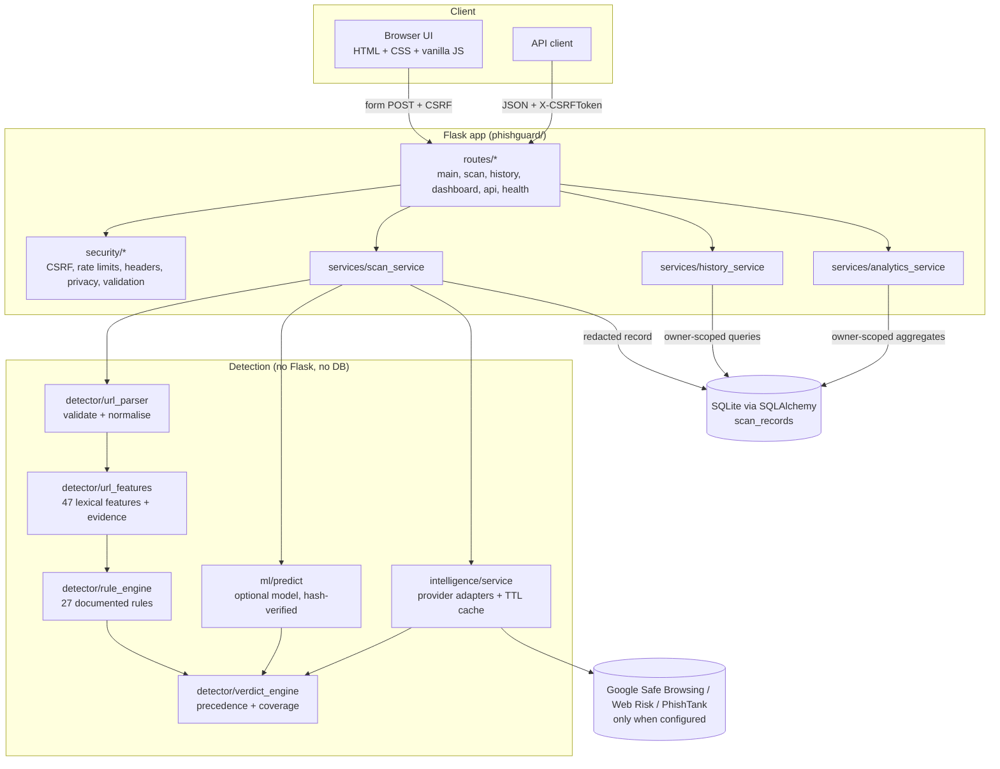

# Architecture

PhishGuard is a Flask application with a strict separation between HTTP handling, business logic and detection logic. The detection packages (`detector`, `intelligence`, `ml`) have **no dependency on Flask or the database** and can be used and tested on their own.

## Request flow for a scan

1. `POST /scan` (form) or `POST /api/v1/scan` (JSON). Flask-WTF checks the CSRF token; Flask-Limiter applies `SCAN_RATE_LIMIT`.
2. The route calls `ScanService.scan_and_store(raw_url, owner)`; routes contain no detection logic.
3. `parse_url` validates and normalises. Invalid input raises `URLValidationError` with a user-facing message (HTTP 400 page / 422 JSON).
4. `extract_features` → `rule_engine.evaluate` produce findings. Any exception here yields an *Inconclusive* verdict instead of a 500.
5. `ReputationService.check` queries configured providers in parallel with timeouts; completed lookups are cached (keyed by SHA-256, not the URL).
6. `ModelPredictor.predict` returns a score or a non-OK status (no model, disabled, integrity failure, incompatible feature set).
7. `verdict_engine.decide` applies the precedence, records each component's status and lists the limitations of this particular scan.
8. A `ScanRecord` is stored with a redacted display URL, a keyed URL fingerprint, the findings and statuses, and an expiry date. The browser is redirected (303) to `/scans/<id>`.

## Modules

| Path | Responsibility |
|---|---|
| `app.py`, `config.py` | Entry point (binds 127.0.0.1) and centralised configuration from environment / `.env` |
| `phishguard/__init__.py` | Application factory; imports the web stack lazily |
| `phishguard/extensions.py` | SQLAlchemy, Migrate, CSRFProtect, Limiter instances |
| `phishguard/cli.py` | `flask init-db`, `flask purge-expired` *(added)* |
| `phishguard/routes/` | Blueprints and error handlers (HTML for pages, JSON under `/api/`) |
| `phishguard/services/` | Scan orchestration, owner-scoped history, dashboard statistics |
| `phishguard/detector/` | Parsing, features, rules, verdicts, scoring, wording |
| `phishguard/detector/public_suffix.py` | Offline registered-domain computation *(added)* |
| `phishguard/detector/brands.py` | Protected brands and official domains *(added)* |
| `phishguard/intelligence/` | Provider contract, Google and PhishTank adapters, cache, service |
| `phishguard/ml/` | Preprocessing, training, evaluation, metadata, inference |
| `phishguard/models/` | `ScanRecord` |
| `phishguard/schemas/` | JSON envelope and scan serialisation |
| `phishguard/security/` | Validation, rate-limit keys, headers, privacy helpers |
| `phishguard/templates/`, `static/` | Server-rendered UI; no inline scripts or styles (strict CSP) |
| `migrations/` | Alembic environment and the initial migration |
| `scripts/` | `init_db.py`, `prepare_dataset.py` *(added)*, `train_model.py`, `evaluate_model.py` |

### Deviations from the original blueprint

* **Added** `detector/public_suffix.py`, `detector/brands.py`, `phishguard/cli.py`, `scripts/prepare_dataset.py`, `templates/api_docs.html`, `templates/_macros.html`, `templates/_icons.html`, `tests/fixtures_urls.py`.
* **Errors**: one template, `templates/errors/error.html`, renders every error status instead of one file per status.
* **Chart.js not used**: the dashboard draws its two charts with CSS and a few lines of JavaScript, plus a table alternative. This keeps the Content-Security-Policy at `'self'` with no CDN and no extra dependency.
* `security/rate_limits.py` holds the limiter key function and the configurable scan limit; limits themselves are configured through `RATELIMIT_*` settings.

## Data model

`scan_records`:

| Column | Notes |
|---|---|
| `id` | UUIDv4 string, primary key |
| `created_at`, `expires_at` | Naive UTC; `expires_at = created_at + SCAN_RETENTION_DAYS` |
| `owner_hash` | HMAC-SHA256 of the anonymous browser ID in the session cookie |
| `url_fingerprint` | HMAC-SHA256 of the normalised URL (keyed with `SECRET_KEY`) |
| `display_url` | Redacted: no credentials, query **values** or fragment; path truncated |
| `host` | Hostname (Unicode form) for search |
| `normalized_url` | `NULL` unless `STORE_NORMALIZED_URL=true` |
| `verdict`, `heuristic_index`, `status` | Result summary |
| `detector_version`, `model_version` | Provenance |
| `is_demo` | Marks synthetic demonstration scans |
| `findings`, `provider_results`, `ml_result`, `component_status`, `result` | JSON |

Indexes: `created_at`, `expires_at`, `owner_hash`, `url_fingerprint`, `host`, `verdict`, `is_demo`, and `(owner_hash, created_at)`.

Schema changes go through Alembic (`flask --app app db migrate`, then `db upgrade`). `init_database()` runs `upgrade`; if the migration environment is unusable it falls back to `create_all()` and stamps the revision.

PostgreSQL works by setting `DATABASE_URL` (and installing a driver such as `psycopg`); only portable column types are used.
